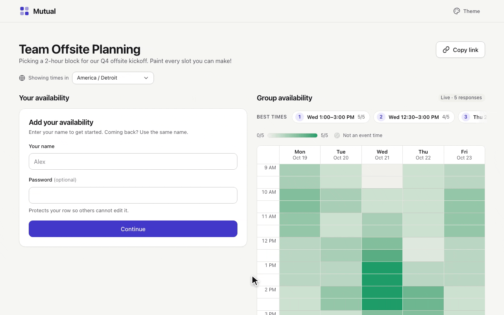

# Mutual



A prettier, self-hosted take on When2Meet. Create an event, share a link, and everyone
paints the times they are free (or only *if needed*). The group view shows a live
heatmap and a ranked list of the best meeting times.

- **Three-state availability**: *Available*, *If needed*, or unavailable, painted by
  click-and-drag on desktop and by touch on phones.
- **Live group view**: the heatmap updates in real time as others save (Server-Sent Events).
- **Timezone aware**: each viewer sees the grid in their own timezone. Event slots stay
  defined in the event's timezone.
- **Participant passwords**: a name can be protected so nobody else can change that row.
- **Private admin links**: the creator gets an admin link to edit or delete the event
  from any device.
- **12 themes** with light and dark variants, picked per visitor.
- **Self-hosted**: a single Docker image and a SQLite database. No external services are
  required, and an optional Cloudflare Tunnel exposes it publicly.

The full product and API contract lives in [`SPEC.md`](SPEC.md).

## Tech stack

- **Server**: Node.js 22+, TypeScript, [Hono](https://hono.dev), `better-sqlite3`, Zod
- **Web**: React 19, Vite, TypeScript, React Router
- **Deploy**: multi-stage Dockerfile and Docker Compose

`server/` and `web/` are independent npm projects with their own lockfiles.

## Quick start (local development)

Requirements: Node.js 22 or newer.

```sh
git clone https://github.com/DarkEden-coding/Mutual.git
cd Mutual
npm run install:all
npm run dev
```

- The web app runs on <http://localhost:5173>.
- The API runs on port `8787`. Vite proxies `/api` to it.

Environment variables are read from your shell for local runs. The server does not load
`.env` itself. See [Configuration](#configuration).

### Scripts

| Command | What it does |
|---|---|
| `npm run install:all` | Installs dependencies for `server/` and `web/` |
| `npm run dev` | Runs the API and the Vite dev server together |
| `npm run build` | Type-checks and builds the web app, then builds the server |
| `npm start` | Starts the production server (serves the built web app too) |
| `npm test` | Runs the server and web test suites |

For server-only checks, use `npm --prefix server run build` and `npm --prefix server test`.

## Deploy with Docker Compose

Requires Docker Compose v2.24.0 or newer (for the optional `env_file`).

```sh
git clone https://github.com/DarkEden-coding/Mutual.git
cd Mutual
cp .env.example .env
# Edit .env. Set TUNNEL_TOKEN only if you use the tunnel profile.
docker compose up -d --build
```

The app listens on `127.0.0.1:8787` on the host. It is not published to your LAN.

What Compose does for you:

- Runs the app as a non-root user with a read-only root filesystem, no Linux capabilities,
  and CPU, memory, and process limits.
- Stores the SQLite database and the generated session secret in the `mutual-data` named
  volume. No host directory or `chown` is needed.
- Fixes `NODE_ENV=production`, `PORT=8787`, and `DATA_DIR=/data`, whatever `.env` says.

Keep the Compose project name stable when you update. That is how Compose reuses the same
volume. Compose prefixes the volume name with the project name.

### Public access with Cloudflare Tunnel

1. Create a remotely managed tunnel in the Cloudflare dashboard.
2. Put its token in `.env` as `TUNNEL_TOKEN`.
3. Set the public hostname's service to **`http://app:8787`**.
4. Start the optional connector:

   ```sh
   docker compose --profile tunnel up -d
   ```

If you run `cloudflared` on the host instead, point the service at **`http://localhost:8787`**.

Use the tunnel's HTTPS hostname for normal access. Cookies are `Secure` by default in
production. Compose sets `TRUST_PROXY=cloudflare`, so rate limits use the real client IP
from `CF-Connecting-IP`. Set `TRUST_PROXY=none` if you reach the app directly, and only
trust Cloudflare headers when requests really pass through Cloudflare.

Every request that changes data must come from the app's own origin and use
`Content-Type: application/json`. Pages on other sites, including sibling subdomains that
share your cookies' site, are rejected with `403`. Password sign-ins are limited per
participant (10 attempts, then 1 every 6 minutes) on top of the per-IP limits, and IPv6
clients are limited per /64. Each IP can hold 20 live update connections, each event 300,
and the server 2000. Rate-limit state is saved in the database on shutdown, so restarts do
not reset it.

In the Cloudflare dashboard, set **SSL/TLS → Edge Certificates → Minimum TLS Version** to
**TLS 1.2**.

Live updates depend on SSE responses not being cached or buffered. The server sends the
right headers. In Cloudflare, do not cache `/api`. Optionally add a Cache Rule with
**Bypass cache** for `/api/*`.

### Testing over plain HTTP

For temporary testing without HTTPS, set `COOKIE_SECURE=false` in `.env` and run
`docker compose up -d` to recreate the app. Then open `http://localhost:8787`, or forward
the loopback port over SSH. Remove the override before you serve it over HTTPS.

## Updating

The named volume is preserved across updates:

```sh
git pull
docker compose up -d --build
# If you use the optional connector:
docker compose --profile tunnel up -d
```

## Backups and restore

The database uses SQLite in WAL mode, so copying only `mutual.sqlite` can lose recent
changes. Use SQLite's online backup API instead:

```sh
mkdir -p backups
chmod 700 backups
docker compose exec -T app node -e 'const DB = require("better-sqlite3"); const db = new DB("/data/mutual.sqlite", { readonly: true }); db.backup("/tmp/mutual-backup.sqlite").then(() => db.close()).catch(error => { console.error(error); db.close(); process.exitCode = 1; });'
# /tmp is a tmpfs, which `docker compose cp` cannot read, so stream the files out instead.
docker compose exec -T app cat /tmp/mutual-backup.sqlite > ./backups/mutual.sqlite
docker compose exec -T app rm /tmp/mutual-backup.sqlite
# If SESSION_SECRET is empty, also keep the generated secret:
docker compose exec -T app cat /data/secret > ./backups/secret
chmod 600 ./backups/*
```

Keep `.env` safe too, especially if it sets `SESSION_SECRET`. Store dated copies off the
server.

To restore: stop the app, replace the database (and the secret, if you backed one up) in
the volume, and remove any stale `mutual.sqlite-wal` and `mutual.sqlite-shm` files. Make
sure UID/GID 1000 owns the restored files, then start the app with the same
`SESSION_SECRET` setup as before.

`docker compose down` keeps your data. `docker compose down -v` deletes the volume.

## Configuration

Copy `.env.example` to `.env` for Compose. Every variable is optional unless noted.

| Variable | Default | Purpose |
|---|---|---|
| `PORT` | `8787` | Server port. Compose fixes it at `8787`. |
| `DATA_DIR` | `./data` | Database and secret directory. Compose fixes it at `/data`. |
| `SESSION_SECRET` | *(empty)* | Signs participant cookies. Empty generates one and saves it to `DATA_DIR/secret`. |
| `TRUST_PROXY` | `cloudflare` (Compose) | `cloudflare` reads `CF-Connecting-IP` and falls back to the socket address. `none` uses the socket address. |
| `COOKIE_SECURE` | *(empty)* | `true`/`false`. Empty means `true` in production and `false` otherwise. |
| `EVENT_TTL_DAYS` | `180` | Deletes events inactive for this many days. `0` disables cleanup. |
| `NODE_ENV` | — | `production` enables static web serving and Secure cookies. Set by Docker. |
| `WEB_DIST` | `web/dist` | Directory of the built web app. Docker sets `/app/web/dist`. |
| `HOST_PORT` | `8787` | Compose only. Host port, bound to `127.0.0.1`. |
| `TUNNEL_TOKEN` | — | Compose only. Cloudflare Tunnel token for the `tunnel` profile. |

## Project layout

```
.
├── server/          Hono API, SQLite storage, SSE stream; serves web/dist in production
│   ├── src/         app.ts, database.ts, model.ts, security.ts, index.ts
│   └── test/        API tests (Vitest)
├── web/             React + Vite single-page app
│   ├── src/pages/       Home, EventPage, KitchenSink, NotFound
│   ├── src/components/  Grid, dialogs, tooltips, theme picker, and more
│   ├── src/themes/      One folder per theme (meta.ts + theme.css)
│   └── THEMING.md       How themes map onto the shared design tokens
├── SPEC.md          Product scope, slot model, and HTTP/SSE contract
├── Dockerfile
└── docker-compose.yml
```

Event slots are stored in the event's timezone. Conversion to each viewer's timezone
happens in the browser, and the server only validates IANA names. See `SPEC.md` for the
details.

## Contributing

Issues and pull requests are welcome. Before opening a pull request, run `npm run build`
and `npm test`. If you change the API or the slot model, update `SPEC.md` in the same change.

## License

No license has been chosen yet. Until one is added, all rights are reserved by the
author.
